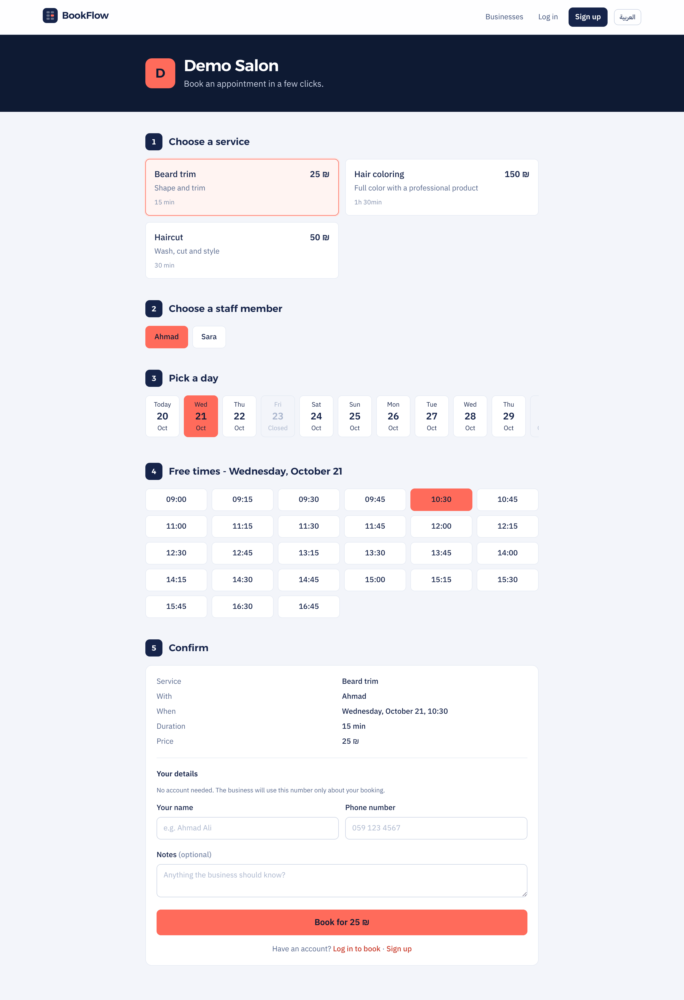
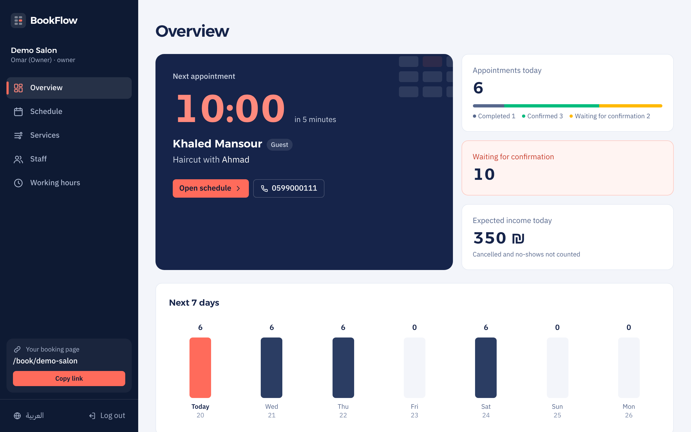
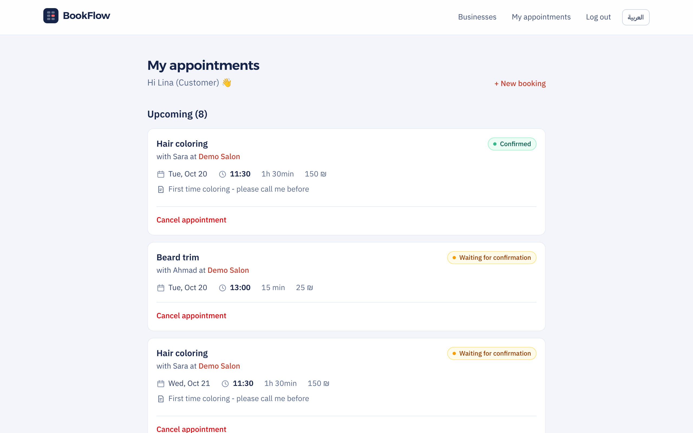
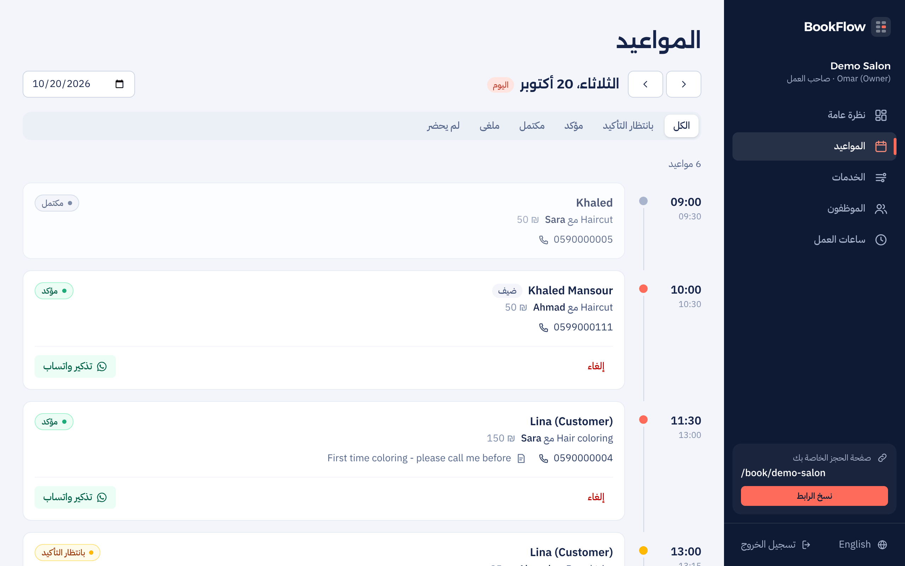
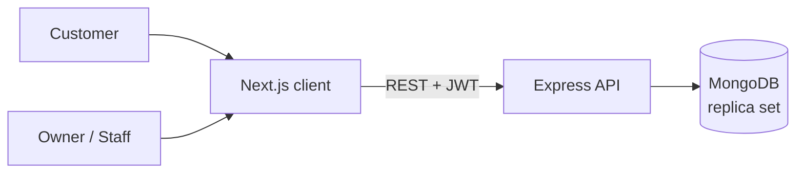
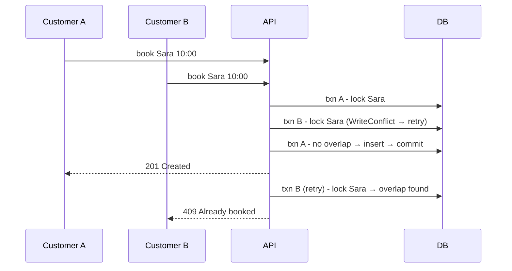

# BookFlow

[](https://github.com/abdalrhmn2021/BookFlow/actions/workflows/server-tests.yml)

**Multi-tenant appointment booking platform** for salons, clinics, gyms and training centers.
Every business gets its own booking page; customers pick a service, a staff member and a free time slot - and **double bookings are impossible, even under concurrent requests**.

🔗 **Live demo:** [book-flow-eight.vercel.app](https://book-flow-eight.vercel.app) &nbsp;·&nbsp; 🌐 Arabic (RTL) + English

| Try it as | Email | Password |
|---|---|---|
| Customer | `customer@demo.com` | `password123` |
| Business owner | `owner@demo.com` | `password123` |
| Staff member | `sara@demo.com` | `password123` |

> The login page also has one-click demo buttons.
> ⏳ The API runs on Render's free tier - if it was asleep, the first request can take ~50 seconds.

| Booking page | Business dashboard |
|---|---|
|  |  |
| **My appointments** | **Arabic / RTL** |
|  |  |

---

## Features

**Customers**
- Browse businesses and book in 5 steps: service → staff → day → free time → confirm
- **Book as a guest** - just a name and a phone number, no account needed (phone normalized, Arabic digits accepted, max 3 upcoming bookings per phone per business, own rate limit)
- **Private "manage my booking" link for guests** - a random 192-bit token in the URL (`/booking/<token>`); only its SHA-256 hash is stored. The guest can copy it or send it to themselves on WhatsApp, then see or cancel the booking (same 2-hour + reason rules as customers). Phone shown masked, page is `noindex`, link endpoints are rate limited
- Only real free slots are offered (working hours, existing bookings, past times all excluded)
- Choices survive the login redirect - pick first, log in after
- "My appointments": upcoming & past, cancel with confirmation
- **Forgot password** by email (one-use link, 30 minutes, only its hash stored) and **change password**; either one signs out every other device

**Business owners & staff**
- Business sign-up creates the business **and** its owner in one transaction
- **Overview** page: the next appointment, today's count / to-confirm / expected income, and the next 7 days as a bar chart - all from one API call
- Daily schedule (timeline) with status workflow: `pending → confirmed → completed / no-show`, or `cancelled`
- Manage services (soft delete), staff accounts (deactivate / reactivate) and weekly working hours
- **The owner can take bookings too** ("I take bookings too" on their own card): a barber who runs the shop alone needs no second account - customers book the owner like any staff member, with the same double-booking lock, own hours, services and days off
- **Per-staff schedules**: each staff member's own week (narrowed to the business's hours, never widened), single days off, and the services they do - the booking page only offers staff who do the chosen service, and only their own free times
- Staff see only **their own** appointments - enforced by the API, not the UI
- **Automatic WhatsApp reminder** before each appointment (Meta WhatsApp Cloud API, approved template), plus a one-tap manual WhatsApp button; a booking is never reminded twice, even with two job runs at once
- **Stale bookings close themselves**: a `pending` booking nobody confirmed can be closed after it starts, and is closed automatically a day after it ends
- **New-booking alerts**: the dashboard chimes and shows a card within 30 s (plus a system notification in the background), and an Arabic + English email goes to the owner and the booked staff member (Brevo HTTPS API)
- **Phone & walk-in bookings** from the dashboard (confirmed at once, phone optional, a manage link to send on WhatsApp) and **rescheduling** to another time or staff member, under the same double-booking lock as online bookings

**Platform**
- Own navy + coral design system (Tailwind v4 theme tokens), Alexandria + IBM Plex Sans Arabic for both scripts
- Full Arabic / English with RTL layout, no flash on load (language stored in a cookie, read on the server)
- Backend error messages translated on the client
- One-click demo accounts + a seed script with realistic sample data
- **Seller admin panel** (`/admin`, superadmin only): every client business with its usage, switch a business off / on, its plan and paid-until date
- On a shared server each business has **its own customer accounts** (the same email at two salons = two separate accounts)

## Tech stack

| Layer | Tech |
|---|---|
| Frontend | Next.js 16 (App Router), React 19, TypeScript, Tailwind CSS 4 |
| Backend | Node.js, Express 5, Mongoose 9 |
| Database | MongoDB (replica set - required for transactions) |
| Auth & security | JWT in an httpOnly cookie, bcrypt, helmet, express-rate-limit, CORS allow-list |

## Architecture



The repo is a monorepo: `client/` (Next.js) and `server/` (Express) are deployed separately.

## Technical decisions

These are the parts I found most interesting to solve.

### 1. Preventing double bookings (race condition)
Checking "is this staff member free?" and then saving is **two** steps. Two customers booking the same slot at the same millisecond can both pass the check before either one saves.

The fix: every staff member has a small **lock document**. A booking runs inside a MongoDB **transaction** that first writes to that lock, then checks for overlaps, then inserts. A second concurrent transaction on the same staff member hits a `WriteConflict`, is retried automatically - and on retry it sees the first booking and gets **409 Conflict**.



Proven by an automated test ([`server/tests/booking.test.js`](server/tests/booking.test.js)): it fires **10 bookings for the same slot at once** - exactly 1 succeeds, the other 9 get 409.
On the frontend, a 409 reloads the free slots so the taken time disappears.

### 2. Multi-tenancy & data isolation
- `tenantId` comes **only** from the verified JWT - never from the body, query or URL.
- Every query by id also filters by `tenantId`, so another business's data simply "doesn't exist" (**404, not 403** - we don't even confirm it exists). This prevents IDOR.
- The business's `isActive` flag is checked on **every** request, because a JWT stays valid after an admin disables the business.
- Public endpoints return hand-built DTOs: staff are exposed as `{ id, name }` only.

### 3. Time zones
A business says "10:30" in **its** local time; MongoDB stores UTC. The server converts local ↔ UTC using the business's IANA time zone (e.g. `Asia/Hebron`), "today" is computed in the business's zone, and calendar dates (`2026-10-03`) are never parsed as moments - so a customer abroad never sees the wrong day.

### 4. Appointment state machine
Allowed transitions live in one map (`completed`, `cancelled`, `no-show` are final), plus time rules (can't mark "completed" before it starts). Updates are **atomic compare-and-set**: `findOneAndUpdate({ _id, status: current })` - if the customer cancelled a second earlier, the owner's update fails with 409 instead of silently overwriting it.

### 5. Other details
- **Price snapshot:** an appointment copies the service's name/price/duration, so editing a service never rewrites history.
- **Soft deletes** for services and staff - old appointments keep valid references.
- **Mass-assignment protection:** controllers whitelist the fields a client may set; `role` and `tenantId` are always set by the server.
- **Brute-force protection:** rate limits on login/registration/public routes (`trust proxy` set in production so limits work behind a hosting proxy).
- **Fail-fast config:** the server refuses to start with missing env vars or a weak `JWT_SECRET`.
- **i18n without a library:** a typed dictionary - TypeScript fails the build if an Arabic key is missing.

## Project structure

```
BookFlow/
├── client/                  Next.js frontend
│   └── src/
│       ├── app/             pages: book/[slug], businesses, dashboard, my-appointments, login, register...
│       ├── components/      Navbar, RequireAuth, StatusBadge, dashboard/ tabs
│       ├── context/         AuthContext (who is logged in), BrandContext (white-label name/logo)
│       ├── i18n/            dictionaries (ar/en) + LanguageContext
│       └── lib/             api client, types, formatting, brand.ts + color.ts (white-label)
├── server/                  Express API
│   ├── src/
│   │   ├── controllers/     business logic per resource
│   │   ├── middlewares/     auth, tenant, site (which business this site is), rate limit, errors
│   │   ├── models/          Mongoose schemas
│   │   ├── routes/
│   │   ├── services/        booking (double-booking safe), business + owner creation,
│   │   │                    reminder + whatsapp (automatic reminders), maintenance (stale bookings), notify (emails)
│   │   └── utils/           time-zone & overlap helpers, staff schedules, phone numbers, tokens
│   ├── scripts/             seed.js (demo data), setup-client.js (a sold copy's business + owner),
│   │                        create-admin.js (the seller's admin account)
│   ├── tests/               Jest + Supertest API tests (in-memory MongoDB replica set)
│   └── api-tests.http       every endpoint, runnable in VS Code REST Client
├── docs/INSTALL.md          install guide for each sold copy (Arabic)
└── render.yaml              backend deploy blueprint
```

## Run locally

**Requirements:** Node.js 20+ and a MongoDB **replica set** (transactions need one).
The easiest option is a free [MongoDB Atlas](https://www.mongodb.com/atlas) cluster. A plain local `mongod` will **not** work unless you start it as a single-node replica set.

```bash
# 1) Backend
cd server
cp .env.example .env        # set MONGO_URI and a JWT_SECRET of 32+ characters
npm install
npm run seed                # demo business, staff, customers and sample bookings
                            # (for a real client use `npm run setup-client` instead - see below)
npm run dev                 # http://localhost:5000

# 2) Frontend (new terminal)
cd client
cp .env.example .env.local
npm install
npm run dev                 # http://localhost:3000
```

Generate a secret: `node -e "console.log(require('crypto').randomBytes(64).toString('hex'))"`
Reset the demo data any time: `npm run seed -- --reset`

### Tests
```bash
cd server
npm test
```
141 API tests (Jest + Supertest) on a real MongoDB replica set in CI: 10 concurrent bookings for the same slot (exactly 1 wins), tenant isolation (404 across businesses), the shared server's site scope, the status state machine, cancellation rules, guest bookings, staff schedules, WhatsApp reminders (never twice), password reset, the admin panel and the new-client setup.
Locally they run against a separate `bookflow_test` database on your `MONGO_URI` cluster (the app's own database is never touched);
on GitHub Actions they run on every push against a MongoDB replica set started in Docker.

### Code style
```bash
npm install        # in the repo root (Prettier only)
npm run format     # format everything
```
CI checks formatting on every push and pull request.

## Deployment

| Part | Host | Settings |
|---|---|---|
| Database | MongoDB Atlas (free M0) | Network access: allow `0.0.0.0/0` |
| Backend | Render (free) | Blueprint from `render.yaml` - set `MONGO_URI` and `CLIENT_URL` |
| Frontend | Vercel | Root directory `client`, env `API_URL=https://<render-app>.onrender.com` (no `/api`) - `next.config.ts` proxies `/api/*` there |

> Render's free tier sleeps after 15 minutes of inactivity - the first request can take ~50 seconds.

## Selling a copy to one business (white-label)

The same code runs as a **branded site for one business** - no code changes, only environment variables:

| Variable (client) | Effect |
|---|---|
| `SINGLE_BUSINESS_SLUG` | `/` opens that business's booking page; the directory and "register a business" are hidden |
| `SITE_PROXY_SECRET` | Shared with the server; `client/src/proxy.ts` signs every `/api` request with it, plus the site's slug and the visitor's IP |
| `BRAND_NAME` · `BRAND_NAME_AR` | Name in the header, dashboard and browser tab |
| `BRAND_LOGO_URL` | Logo (a file in `client/public` or a full URL), also the tab icon |
| `BRAND_COLOR` | One hex color → the full button / highlight / link palette, generated in OKLCH with readable contrast (`client/src/lib/color.ts`) |

A new client's business and owner account are created with one command - no demo data:

```bash
cd server
npm run setup-client -- --name "Laila Salon" --slug laila-salon --owner "Laila" --email laila@example.com
```

### One server for every client

All sold copies run on **one shared server + database** (`SHARED_SERVER=true`); each client only gets
their own Vercel site. The site's proxy sends the secret, its business slug and the visitor's IP; the
server trusts the slug only when the secret matches (constant-time compare) and then scopes everything
to that business - the directory, booking pages, guest "manage my booking" links, customer lists,
owner/staff login and the dashboard. Business sign-up is closed on a shared server (clients are added
with `setup-client`), and rate limits count the real visitor instead of the Vercel proxy's IP.
Dashboard data stays isolated by the logged-in user's `tenantId` exactly as before - the site scope is
an extra layer on top, not the security boundary. A client who needs fully separate data can still get
a dedicated server (`SINGLE_BUSINESS_SLUG` on the server).

Step-by-step install guide (Arabic): [`docs/INSTALL.md`](docs/INSTALL.md).

## API overview

| Method | Endpoint | Access |
|---|---|---|
| POST | `/api/auth/register` · `/api/auth/login` · `/api/auth/register-business` | public |
| POST | `/api/auth/forgot-password` · `/api/auth/reset-password` | public |
| PATCH | `/api/auth/password` | logged in |
| GET | `/api/auth/me` | logged in |
| GET | `/api/public/businesses` · `/api/public/businesses/:slug` · `/api/public/businesses/:slug/availability` | public |
| POST | `/api/appointments` | customer |
| GET · PATCH | `/api/appointments/me` · `/api/appointments/:id/cancel` | customer |
| GET · PATCH | `/api/appointments/business` · `/api/appointments/:id/status` | owner, staff |
| GET | `/api/appointments/business/stats` (dashboard overview) | owner, staff |
| GET | `/api/appointments/business/new?since=` (new-booking alerts) | owner, staff |
| POST · PATCH | `/api/appointments/business` (walk-in / phone booking) · `/api/appointments/:id/reschedule` | owner, staff (own) |
| GET | `/api/appointments/business/availability` (free times, `exclude` for rescheduling) | owner, staff |
| CRUD | `/api/services` | owner (staff: read) |
| PATCH | `/api/appointments/:id/reminded` (manual WhatsApp reminder sent) | owner, staff (own) |
| CRUD | `/api/staff` | owner |
| PUT | `/api/staff/:id/schedule` (own hours, days off, services) | owner |
| GET · PUT | `/api/tenants/me` · `/api/tenants/me/working-hours` | owner (staff: read) |
| GET · PATCH | `/api/admin/businesses` · `/api/admin/businesses/:id` | superadmin |
| POST | `/api/jobs/reminders` (for an outside cron, `x-jobs-secret` header) | server secret |

Full request examples: [`server/api-tests.http`](server/api-tests.http).

## Known limitations & roadmap

- [x] Automated tests (Jest + Supertest) and CI - 141 tests: concurrent double booking, tenant isolation, shared-server scope, status transitions, guest booking, staff schedules, reminders, admin
- [x] JWT in an httpOnly cookie instead of `localStorage` (API proxied through Next.js rewrites, so the cookie is first-party)
- [x] Automatic WhatsApp reminder before each appointment (Meta Cloud API template, idempotent job + cron endpoint)
- [x] Per-staff working hours, days off and "which staff can do which service"
- [x] Dashboard overview: next appointment, today's numbers, next 7 days
- [x] Seller admin panel (`/admin`, role superadmin): every client business, usage, switch off/on, plan, paid-until
- [ ] Longer-range analytics (monthly revenue, no-show rate)
- [x] A `pending` booking nobody confirmed can be closed after it starts, and is closed automatically a day after it ends
- [x] Shared server: each business has its own customer accounts (same email = separate account per business)

## Author

**AbdAlrhmn ALkhlwt** - Full-Stack JavaScript Developer · [GitHub](https://github.com/abdalrhmn2021)
